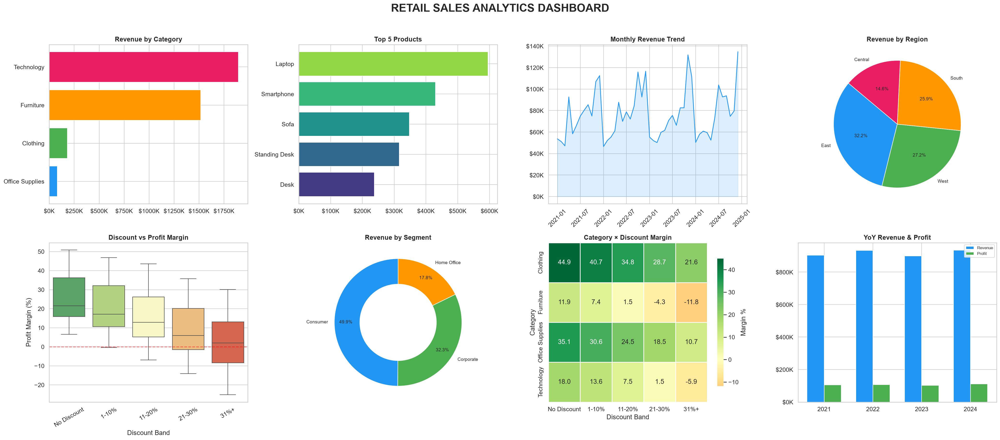

# 📊 Retail Sales Data Analysis

> A beginner-friendly data analysis portfolio project that explores retail sales patterns, identifies top-performing products and regions, and evaluates the impact of discounting strategies on profitability.



---

## 🎯 Business Questions Answered

| # | Question | Key Finding |
|---|----------|-------------|
| 1 | **Which products and categories sell best?** | Technology leads in revenue; Office Supplies leads in volume and profit margin |
| 2 | **Which months have the highest revenue?** | November and December show 35–50% higher revenue (holiday season effect) |
| 3 | **Which regions perform well?** | East and West regions dominate (~58% combined revenue share) |
| 4 | **What is the average order value?** | AOV varies significantly by segment — Corporate orders are largest |
| 5 | **Are discounts improving or hurting profit?** | Discounts above 20% consistently destroy profit margins across all categories |

---

## 📂 Project Structure

```
sales-data-analysis/
├── README.md                      ← You are here
├── data/
│   ├── raw_sales_data.csv         ← Original dataset (with quality issues)
│   └── cleaned_sales_data.csv     ← Cleaned & enriched dataset
│   └── cleaned_sales_data.xlsx    ← Excel version for Sheets/Excel users
├── charts/
│   ├── 00_DASHBOARD.png           ← Combined 8-panel dashboard
│   ├── 01_revenue_by_category.png
│   ├── 02_top10_products.png
│   ├── 03_monthly_revenue_trend.png
│   ├── 04_regional_performance.png
│   ├── 05_discount_vs_profit.png
│   ├── 06_segment_donut.png
│   ├── 07_category_discount_heatmap.png
│   └── 08_yoy_revenue_profit.png
├── sql/
│   └── analysis_queries.sql       ← SQL equivalents for all 5 questions
├── 01_generate_dataset.py         ← Step 1: Generate realistic dataset
├── 02_clean_data.py               ← Step 2: Data cleaning & enrichment
├── 03_analyze_data.py             ← Step 3: Statistical analysis
└── 04_create_dashboard.py         ← Step 4: Visualization dashboard
```

---

## 📋 Dataset Overview

- **~9,900 order line items** across **4 years (2021–2024)**
- **4 categories**: Technology, Furniture, Office Supplies, Clothing
- **4 regions**: East, West, South, Central (20 states)
- **3 customer segments**: Consumer, Corporate, Home Office
- **Key columns**: Order ID, Date, Region, Category, Product, Quantity, Unit Price, Discount, Sales (Revenue), Profit

---

## 🔧 Process & Methodology

### Step 1: Data Generation
Created a realistic retail sales dataset with built-in patterns:
- **Seasonal trends**: Holiday spikes in Nov–Dec, back-to-school in Aug–Sep
- **Regional variation**: East/West regions weighted higher
- **Category margins**: Office Supplies (35%) > Clothing (45%) > Technology (18%) > Furniture (12%)
- **Discount erosion**: Higher discounts progressively eat into profit margins

### Step 2: Data Cleaning
Handled real-world data quality issues:
- ✅ Removed **~98 duplicate rows** (1% of data)
- ✅ Fixed **inconsistent casing** in Region column (e.g., "EAST" → "East")
- ✅ Filled **~200 missing values** in Ship Date, Segment, Region
- ✅ Corrected **~50 negative quantities** (data entry errors)
- ✅ Added **derived columns**: Year, Month, Day of Week, Profit Margin %, Shipping Days, Discount Band

### Step 3: Analysis
Answered all 5 business questions using pandas aggregation, groupby, and correlation analysis.

### Step 4: Visualization
Built 8 professional charts + 1 combined dashboard using matplotlib and seaborn.

---

## 💡 Key Business Insights

### Insight 1: Technology Drives Revenue, But Office Supplies Drives Margin
Technology is the highest-revenue category but has one of the lowest profit margins (~18%). Office Supplies, while lower in per-item revenue, has the highest margin (~35%) and highest order volume.

> **Recommendation**: Invest in Office Supplies marketing — it's the profit engine. Bundle high-margin Office Supplies with Technology products.

### Insight 2: Holiday Season Is Critical (Nov–Dec = ~25% of Annual Revenue)
Revenue spikes sharply in November and December, driven by holiday shopping. January–February are the slowest months.

> **Recommendation**: Allocate 30–40% of marketing budget to Q4. Run pre-holiday promotions in October to extend the peak window.

### Insight 3: East & West Regions Need Different Strategies Than South & Central
East and West combined account for ~58% of revenue. South and Central underperform despite having similar population coverage.

> **Recommendation**: Investigate why Central underperforms — is it product availability, shipping costs, or market saturation? Run targeted campaigns in underperforming states.

### Insight 4: Heavy Discounts (>20%) Destroy Profitability
Orders with discounts above 20% show **negative or near-zero profit margins** across ALL categories. The correlation between discount rate and profit margin is strongly negative (~-0.85).

> **Recommendation**: Cap discounts at 20% maximum. Replace deep discounts with value-added offers (free shipping, bundles). Furniture is especially vulnerable — even 15% discounts push margins negative.

### Insight 5: Corporate Segment Has Highest AOV But Lowest Share
Corporate customers place the largest average orders but represent only ~32% of the customer base. Consumer segment dominates volume (50%) but at lower AOV.

> **Recommendation**: Develop a dedicated B2B sales program. Corporate clients are high-value — even small increases in this segment yield outsized revenue gains.

### Insight 6: Same-Day Shipping Is Underutilized
Same-Day and First-Class shipping modes account for ~25% of orders but customers choosing them tend to buy higher-value products.

> **Recommendation**: Promote expedited shipping for high-margin categories (Technology, Clothing). Consider free fast shipping above a certain order value threshold.

### Insight 7: Clothing Is a Growth Opportunity
Clothing has the **highest profit margin** (~45%) but the lowest revenue share (~15%). It's undertapped.

> **Recommendation**: Expand the Clothing product line. Cross-promote with seasonal campaigns (winter jackets in Q4, summer wear in Q2).

---

## 🛠️ Tools Used

| Tool | Purpose |
|------|---------|
| **Python (pandas)** | Data cleaning, transformation, analysis |
| **matplotlib + seaborn** | Data visualization and dashboard |
| **SQL** | Alternative queries for all analysis questions |
| **Excel/Google Sheets** | Dataset is provided in `.xlsx` format for spreadsheet analysis |

---

## 🚀 How to Run

```bash
# 1. Install dependencies
pip install pandas matplotlib seaborn openpyxl

# 2. Generate the raw dataset
python 01_generate_dataset.py

# 3. Clean the data
python 02_clean_data.py

# 4. Run the analysis
python 03_analyze_data.py

# 5. Generate the dashboard
python 04_create_dashboard.py
```

---

## 📊 Using with Excel / Google Sheets

1. Open `data/cleaned_sales_data.xlsx` in Excel or upload to Google Sheets
2. Create Pivot Tables for:
   - Revenue by Category (rows) × Year (columns)
   - Revenue by Region → use Insert Chart → Pie Chart
   - Profit by Discount Band → Bar Chart
3. Use conditional formatting to highlight top-performing products
4. Create a Pivot Chart dashboard on a separate sheet

---

## 📊 Using with SQL

1. Import the CSV into SQLite, PostgreSQL, or MySQL
2. Run the queries in `sql/analysis_queries.sql`
3. See the file for setup instructions

```bash
# SQLite quick start
sqlite3 sales.db
.mode csv
.import data/cleaned_sales_data.csv sales
-- Then run any query from sql/analysis_queries.sql
```

---

## 📝 About This Project

This project demonstrates core data analysis skills:
- **Data Cleaning**: Handling nulls, duplicates, inconsistencies, and data entry errors
- **Exploratory Data Analysis (EDA)**: Groupby, aggregation, pivot tables, correlation
- **Data Visualization**: Professional charts with proper formatting and labeling
- **Business Thinking**: Translating data patterns into actionable recommendations
- **Multi-Tool Proficiency**: Python, SQL, and Excel/Sheets

Built as a portfolio project to showcase analytical skills for data analyst roles.

---

*Dataset is synthetically generated to mirror real-world retail patterns (inspired by the Superstore dataset). No real customer data is used.*

